Submitted data error checks
================

- [0. Instructions for submitters](#0-instructions-for-submitters)
- [1. Submitter](#1-submitter)
- [2. Contributors](#2-contributors)
- [3. File and directory names](#3-file-and-directory-names)
- [4. Location](#4-location)
- [5.Keys and codes](#5keys-and-codes)
  - [Codes in Treatments sheet](#codes-in-treatments-sheet)
  - [Codes in Plots sheet](#codes-in-plots-sheet)
  - [Codes in Emission sheet](#codes-in-emission-sheet)
  - [Code merge check (matching project, experiment, field, plot,
    treatment)](#code-merge-check-matching-project-experiment-field-plot-treatment)
- [6. Publication info](#6-publication-info)
  - [Check for missing codes](#check-for-missing-codes)
  - [Complete citations given](#complete-citations-given)
- [7. Emission sheet](#7-emission-sheet)
  - [Duplicated intervals](#duplicated-intervals)
  - [Missing incorporation time](#missing-incorporation-time)
  - [Delay after application](#delay-after-application)
  - [Missing or double interval
    number](#missing-or-double-interval-number)
  - [Missing time between intervals](#missing-time-between-intervals)
  - [Measurement method and units](#measurement-method-and-units)
- [7. Value checks](#7-value-checks)
  - [Weather](#weather)
  - [Manure and application](#manure-and-application)
  - [Emission](#emission)
- [8. Missing values](#8-missing-values)
  - [All variables](#all-variables)
  - [Application method and measurement
    method](#application-method-and-measurement-method)
- [9. Plots](#9-plots)
  - [Calculated cumulative emission](#calculated-cumulative-emission)
  - [Final cumulative emission](#final-cumulative-emission)
  - [Relative versus absolute
    emission](#relative-versus-absolute-emission)
  - [Flux](#flux)
  - [Weather data](#weather-data)
  - [Manure and application](#manure-and-application-1)
- [10. Summary](#10-summary)
  - [Plot-level data](#plot-level-data)
  - [Interval-level emission data](#interval-level-emission-data)

# 0. Instructions for submitters

Submitters should use this file to check for problems with submitted
data. Send either a list of problems or confirmation that everything
looks OK to Sasha by email. Be sure to reference the dataset version and
file creation date/time when doing so. These are:

    ## Version:  3.5

    ## [1] "Date/time: 2026-10-23 11:07:33.404375"

Each of these files contains a summary of the data from a single
submitted spreadsheet file. The html name is based on the name of the
submitted file. Use the details below to check:

- Institute abbreviation, submitter and contributor names
- The plot location(s), using the map zoom and pan features if needed
- For problems in the first sections; “OK” means there are no problems
  in a particular section, “warning” is something that should be checked
  (but might be OK), “error” is a problem that needs to be addressed
- For numeric values outside the expected range in the “Value checks”
  section
- Variables with missing values–are there any missing that you thought
  you included?
- Plots of flux, cumulative emission over time, and final cumulative
  emission for strange patterns, unexpectedly high or low values
- Plots of weather data for appropriate differences between plots and
  expected diurnal or other patterns
- Plots of manure and application data for correct values

Finally, the numeric summary at the end might provide details that can
help in pinpointing problems, but typically does not need to be checked.

# 1. Submitter

| inst.abbrev | submitter         | version | date       |
|:------------|:------------------|:--------|:-----------|
| AU          | Pedersen, Johanna | 1       | 2026/10/07 |

# 2. Contributors

| contributor | institute | sub.period | file |
|:---|:---|---:|:---|
| Hafner, Sasha | AU | 4 | ../../data-submitted/04/AU/ALFAM2_template_8.3_NGrass3+4.xlsx |
| Pedersen, Johanna | Aarhus University | 4 | ../../data-submitted/04/AU/ALFAM2_template_8.3_NGrass3+4.xlsx |

# 3. File and directory names

    ## [1] "../../data-submitted/04/AU"

    ## [1] "../../data-submitted/04/AU/ALFAM2_template_8.3_NGrass3+4.xlsx"

# 4. Location

Location 1: lat=56.48427, long=9.58356 [View on
map](https://maps.google.com/?q=56.48427,9.58356)

# 5.Keys and codes

## Codes in Treatments sheet

    ## OK

    ## OK

## Codes in Plots sheet

    ## OK

    ## OK

## Codes in Emission sheet

    ## OK

    ## OK

## Code merge check (matching project, experiment, field, plot, treatment)

    ## OK

    ## OK

    ## OK

    ## OK

    ## OK

# 6. Publication info

## Check for missing codes

    ## OK

    ## OK

## Complete citations given

    ## OK

    ## OK

# 7. Emission sheet

## Duplicated intervals

    ## OK

## Missing incorporation time

    ## OK

## Delay after application

    ## OK

## Missing or double interval number

    ## OK
    ## OK
    ## OK
    ## OK
    ## OK
    ## OK
    ## OK
    ## OK
    ## OK
    ## OK
    ## OK
    ## OK
    ## OK
    ## OK
    ## OK
    ## OK
    ## OK
    ## OK
    ## OK
    ## OK
    ## OK
    ## OK
    ## OK
    ## OK
    ## OK
    ## OK
    ## OK
    ## OK
    ## OK
    ## OK
    ## OK

## Missing time between intervals

    ## OK
    ## OK
    ## OK
    ## OK
    ## OK
    ## OK
    ## OK
    ## OK
    ## OK
    ## OK
    ## OK
    ## OK
    ## OK
    ## OK
    ## OK
    ## OK
    ## OK
    ## OK
    ## OK
    ## OK
    ## OK
    ## OK
    ## OK
    ## OK
    ## OK
    ## OK
    ## OK
    ## OK
    ## OK
    ## OK
    ## OK

## Measurement method and units

Measurement technique:

| Method          | Frequency |
|:----------------|----------:|
| Dynamic chamber |      2137 |

Measurement technique classification:

| Classification | Frequency |
|:---------------|----------:|
| chamber        |      2137 |

Emission units and conversion factors.

| Original unit | Conversion factor applied | Final unit |
|:--------------|--------------------------:|:-----------|
| kg N/ha-hr    |                         1 | kg N/ha-hr |

# 7. Value checks

Check to see if submitted values are within a reasonable range.

## Weather

    ## wind : No values to check.
    ## rain.rate : OK
    ## air.temp : OK
    ## soil.temp : No values to check.
    ## soil.temp.surf : No values to check.
    ## air.temp.z : OK
    ## wind.z : No values to check.

## Manure and application

    ## man.stor : No values to check.
    ## man.dm : OK
    ## man.vs : No values to check.
    ## man.tkn : OK
    ## man.tan : OK
    ## man.tic : No values to check.
    ## man.ua : No values to check.
    ## man.vfa : No values to check.
    ## man.ph : OK
    ## app.rate : OK
    ## crop.z : OK

## Emission

    ## j.NH3 : OK
    ## e.int : OK
    ## e.rel : OK

# 8. Missing values

Check for missing values.

## All variables

    ## Some values missing:
    ## Table below has number of missing observations by variable:
    ##         pub.id  meas.tech.det             oc      soil.type   soil.water.v 
    ##           2137           2137           2137           2137           2137 
    ## man.source.det        man.bed       man.trt2       man.trt3       man.stor 
    ##           2137           2137           2137           2137           2137 
    ##         man.vs        man.tic         man.ua        man.vfa      app.start 
    ##           2137           2137           2137           2137           1019 
    ##        app.end    time.incorp       man.area       dist.inj       furrow.z 
    ##           2137           2137           2137           2137           2137 
    ##       furrow.w      crop.area            lai     notes.plot        pH.surf 
    ##           2137           2137           2137           2069           2137 
    ##      soil.temp    soil.temp.z soil.temp.surf            rad           wind 
    ##           2137           2137           2137           2137           2137 
    ##         wind.z            MOL          ustar             rl       air.pres 
    ##           2137           2137           2137           2137           2137 
    ##  air.pres.unit             rh       wind.loc        far.loc      notes.int 
    ##           2137           2137           2137           2137           2137 
    ##            bta        wind.2m     soil.type2         exper2           rep2 
    ##           1019           2137           2137           2137           2137

## Application method and measurement method

    ## OK

    ## OK

# 9. Plots

## Calculated cumulative emission

Cumulative emission. Missing values imputed (linear interpolation).
Numeric labels show position of data in data file: row in the “Plots”
sheet and first row in the “Emission” sheet. Labels in center of the
first plot have measurement method, manure source, and application
method. The same emission data are plotted a few different ways to
facilitate checking for problems, e.g., comparing plot to each other or
checking application dates. The same colors should be be used for
particular field plots throughout this section.

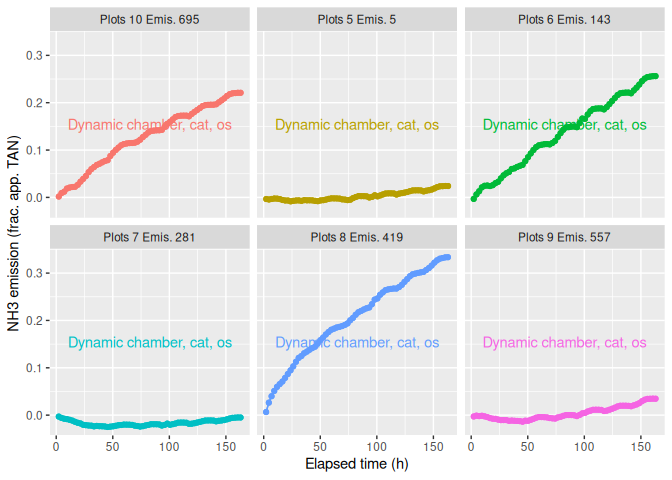<!-- -->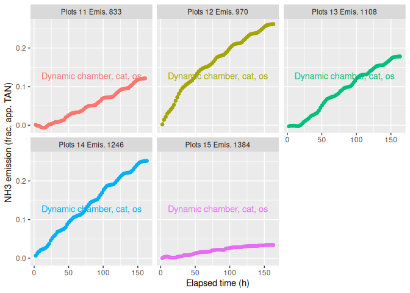<!-- -->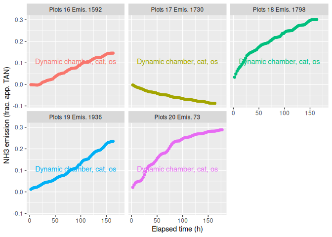<!-- -->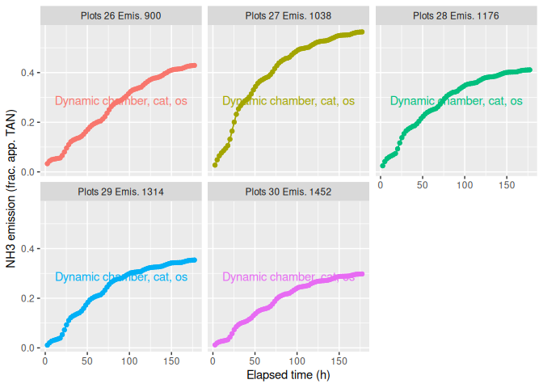<!-- -->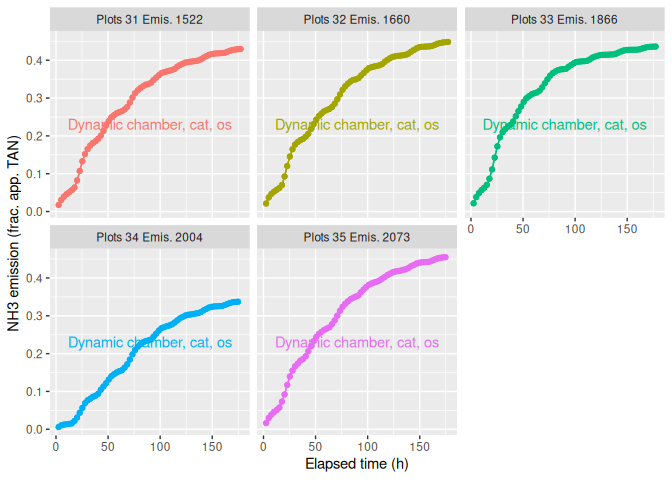<!-- -->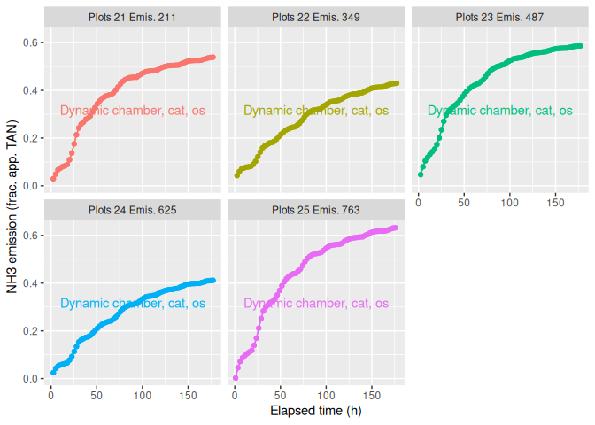<!-- -->

## Final cumulative emission

    ## `stat_bin()` using `bins = 30`. Pick better value `binwidth`.

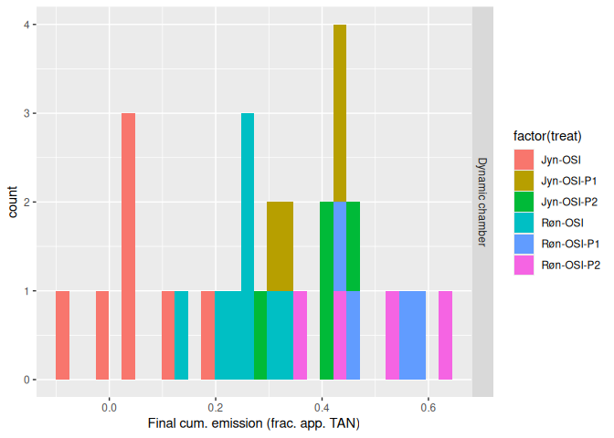<!-- -->

## Relative versus absolute emission

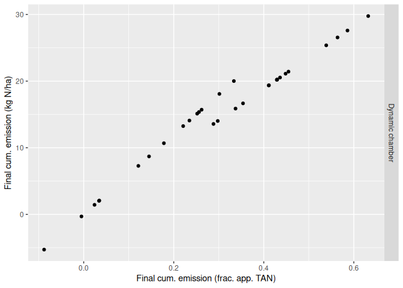<!-- -->

## Flux

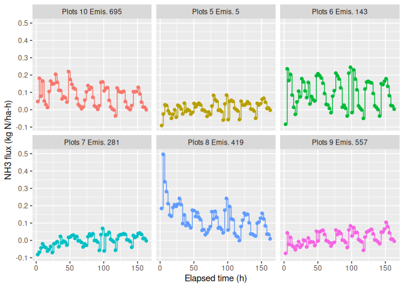<!-- -->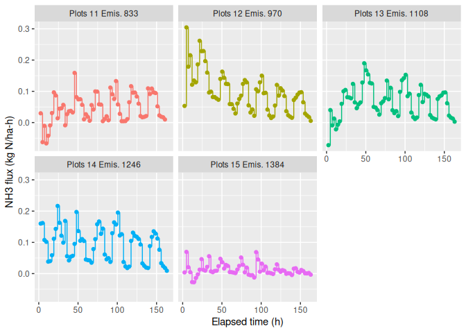<!-- -->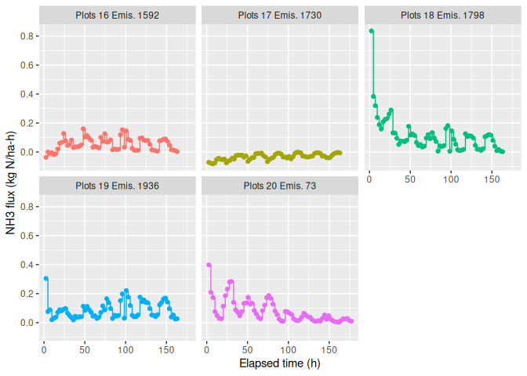<!-- -->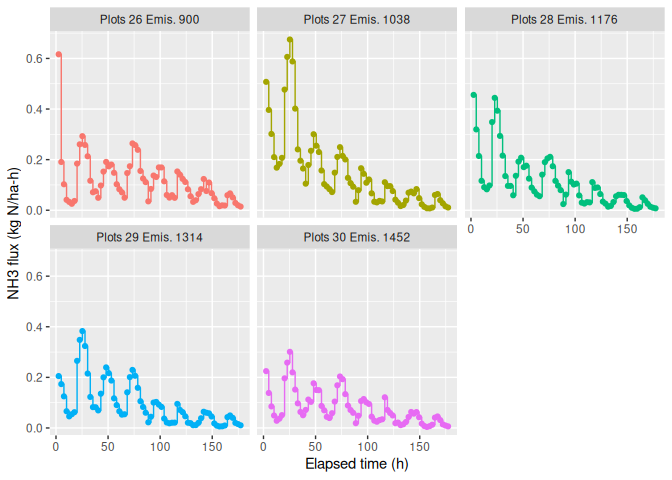<!-- -->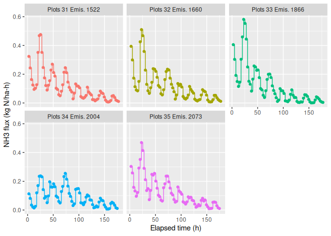<!-- -->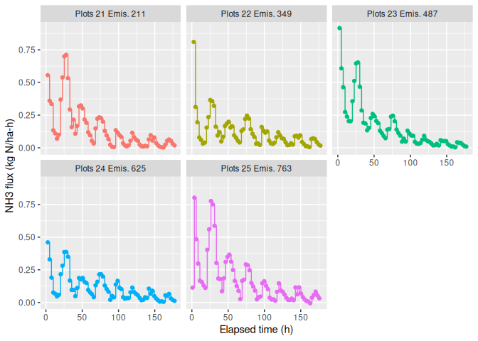<!-- -->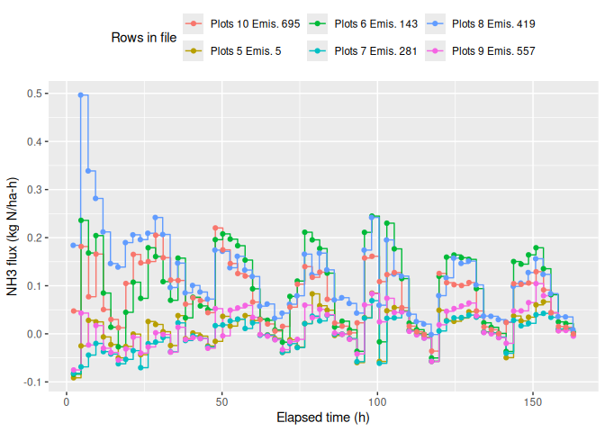<!-- -->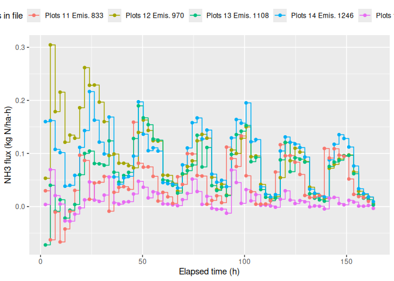<!-- -->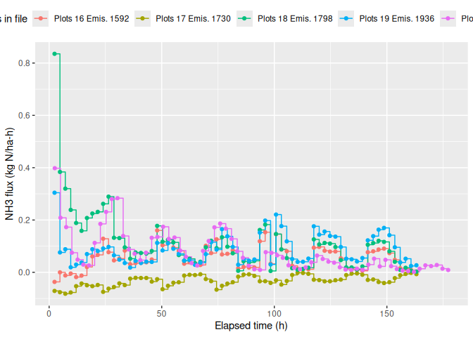<!-- -->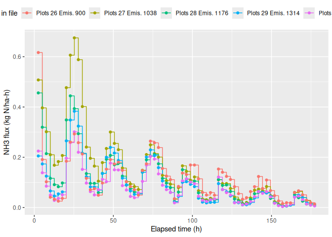<!-- -->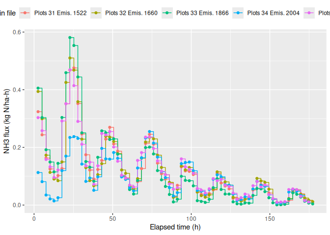<!-- -->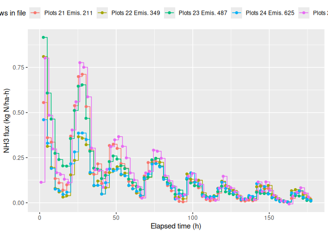<!-- --><!-- -->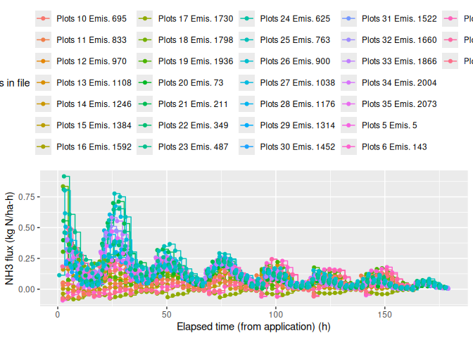<!-- --><!-- --><!-- --><!-- --><!-- -->

## Weather data

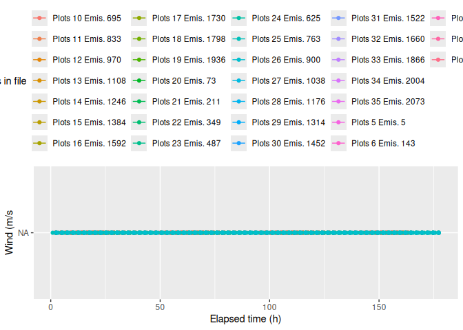<!-- -->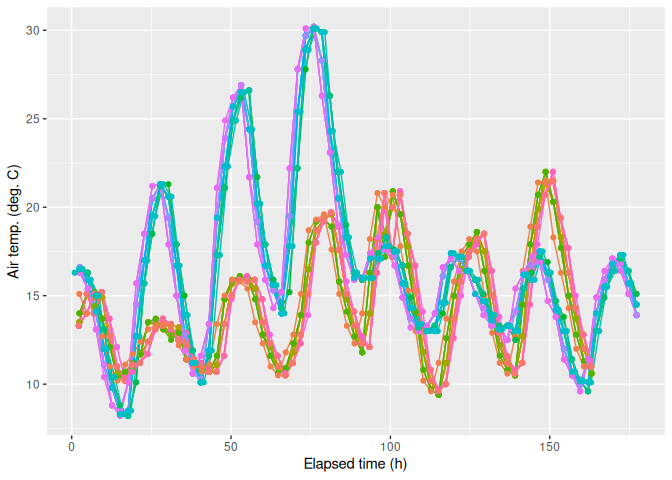<!-- -->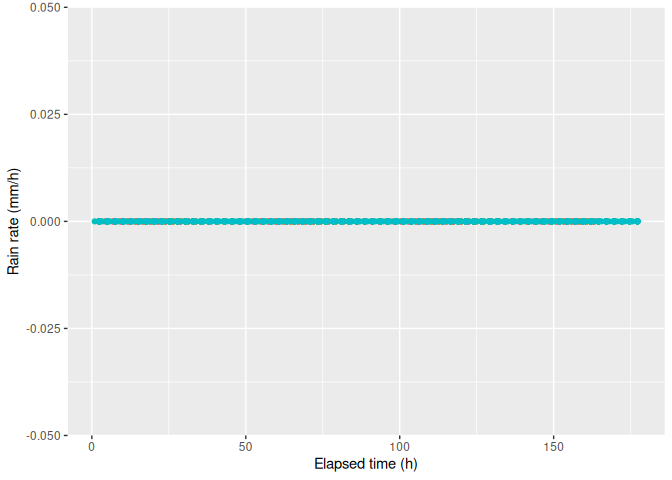<!-- -->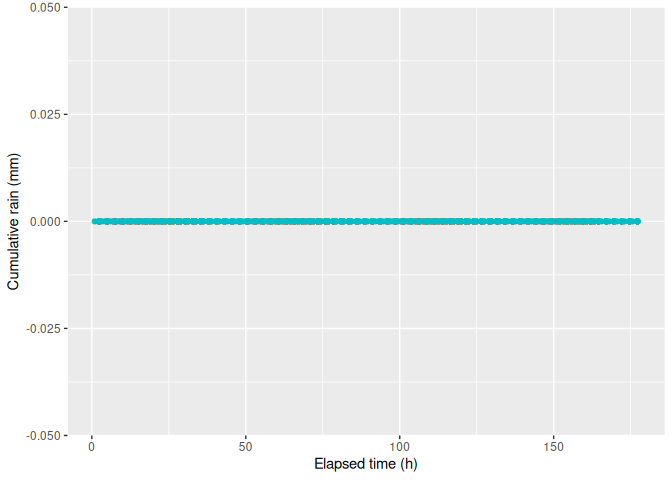<!-- -->

## Manure and application

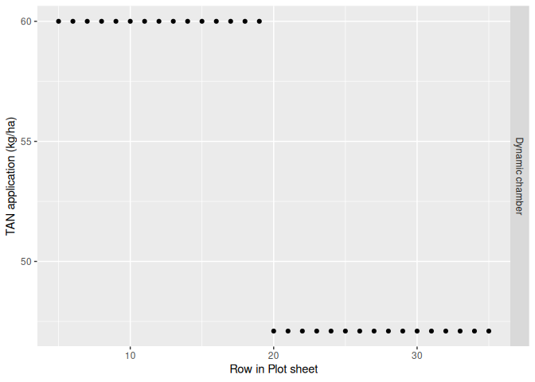<!-- -->

# 10. Summary

## Plot-level data

    ## 
    ##  31 rows and 210 columns
    ##  31 unique rows
    ##                       pub.id      proj     exper
    ## Class              character character character
    ## Minimum                 <NA>   N-Grass   Trial 3
    ## Maximum                 <NA>   N-Grass   Trial 4
    ## Mean                    <NA>      <NA>      <NA>
    ## Unique (excld. NA)         0         1         2
    ## Missing values            31         0         0
    ## Sorted                  <NA>      TRUE      TRUE
    ##                                                 
    ##                                                                                                                                                                                            cpmid
    ## Class                                                                                                                                                                                  character
    ## Minimum                                D:1.I:AU.Pr:N-Grass.F:../../data-submitted/04/AU/ALFAM2_template_8.3_NGrass3+4.xlsx.E:Trial 3.F:semi-field.P:1.T:Jyn-OSI.R:1.R2:.T:NA.M:Dynamic chamberNA
    ## Maximum            D:1.I:AU.Pr:N-Grass.F:../../data-submitted/04/AU/ALFAM2_template_8.3_NGrass3+4.xlsx.E:Trial 4.F:semi-field.P:8.T:Jyn-OSI-P1.R:2.R2:.T:2026-08-11 13:40:00.M:Dynamic chamberNA
    ## Mean                                                                                                                                                                                        <NA>
    ## Unique (excld. NA)                                                                                                                                                                            31
    ## Missing values                                                                                                                                                                                 0
    ## Sorted                                                                                                                                                                                      TRUE
    ##                                                                                                                                                                                                 
    ##                         field      plot       rep plot.area     lat    long
    ## Class               character character character   numeric numeric numeric
    ## Minimum            semi-field         1         1      0.38    56.5    9.58
    ## Maximum            semi-field         8         8      0.38    56.5    9.58
    ## Mean                     <NA>      <NA>      <NA>      0.38    56.5    9.58
    ## Unique (excld. NA)          1        17         8         1       1       1
    ## Missing values              0         0         0         0       0       0
    ## Sorted                   TRUE     FALSE     FALSE      TRUE    TRUE    TRUE
    ##                                                                            
    ##                      country      topo soil.samp.z    clay    silt    sand
    ## Class              character character   character integer integer integer
    ## Minimum                   DK      Flat         0-5       4       5      89
    ## Maximum                   DK      Flat         0-5      18       5      89
    ## Mean                    <NA>      <NA>        <NA>    11.2       5      89
    ## Unique (excld. NA)         1         1           1       2       1       1
    ## Missing values             0         0           0       0       0       0
    ## Sorted                  TRUE      TRUE        TRUE   FALSE    TRUE    TRUE
    ##                                                                           
    ##                         oc soil.type soil.water soil.water.v soil.moist soil.ph
    ## Class              logical   logical    numeric      logical  character numeric
    ## Minimum               <NA>      <NA>       0.05         <NA>        Dry    5.47
    ## Maximum               <NA>      <NA>       0.18         <NA>        Dry    6.65
    ## Mean                  <NA>      <NA>      0.123         <NA>       <NA>    6.09
    ## Unique (excld. NA)       0         0          5            0          1       4
    ## Missing values          31        31          0           31          0       0
    ## Sorted                <NA>      <NA>      FALSE         <NA>       TRUE   FALSE
    ##                                                                                
    ##                    soil.dens  crop.res      till man.source man.source.det
    ## Class                numeric character character  character        logical
    ## Minimum                 1.24       Yes        No        cat           <NA>
    ## Maximum                 1.43       Yes        No        cat           <NA>
    ## Mean                    1.34      <NA>      <NA>       <NA>           <NA>
    ## Unique (excld. NA)         4         1         1          1              0
    ## Missing values             0         0         0          0             31
    ## Sorted                 FALSE      TRUE      TRUE       TRUE           <NA>
    ##                                                                           
    ##                    man.bed   man.con  man.trt1 man.trt2 man.trt3 man.stor
    ## Class              logical character character  logical  logical  logical
    ## Minimum               <NA>    slurry      None     <NA>     <NA>     <NA>
    ## Maximum               <NA>    slurry      None     <NA>     <NA>     <NA>
    ## Mean                  <NA>      <NA>      <NA>     <NA>     <NA>     <NA>
    ## Unique (excld. NA)       0         1         1        0        0        0
    ## Missing values          31         0         0       31       31       31
    ## Sorted                <NA>      TRUE      TRUE     <NA>     <NA>     <NA>
    ##                                                                          
    ##                     man.dm  man.vs man.tkn man.tan man.tic  man.ua man.vfa
    ## Class              numeric logical numeric numeric logical logical logical
    ## Minimum                7.9    <NA>    3.37    1.57    <NA>    <NA>    <NA>
    ## Maximum               8.44    <NA>     3.8       2    <NA>    <NA>    <NA>
    ## Mean                  8.16    <NA>    3.59    1.78    <NA>    <NA>    <NA>
    ## Unique (excld. NA)       2       0       2       2       0       0       0
    ## Missing values           0      31       0       0      31      31      31
    ## Sorted               FALSE    <NA>    TRUE   FALSE    <NA>    <NA>    <NA>
    ##                                                                           
    ##                     man.ph           app.start         app.end app.method
    ## Class              numeric     POSIXct, POSIXt POSIXct, POSIXt  character
    ## Minimum               6.92 2026-08-11 13:34:00            <NA>         os
    ## Maximum               7.26 2026-08-11 13:49:00            <NA>         os
    ## Mean                   7.1 2026-08-11 13:41:30            <NA>       <NA>
    ## Unique (excld. NA)       2                  16               0          1
    ## Missing values           0                  15              31          0
    ## Sorted                TRUE               FALSE            <NA>       TRUE
    ##                                                                          
    ##                    app.rate app.rate.unit    incorp time.incorp man.area
    ## Class               integer     character character     numeric  logical
    ## Minimum                  30          t/ha      none        <NA>     <NA>
    ## Maximum                  30          t/ha      none        <NA>     <NA>
    ## Mean                     30          <NA>      <NA>        <NA>     <NA>
    ## Unique (excld. NA)        1             1         1           0        0
    ## Missing values            0             0         0          31       31
    ## Sorted                 TRUE          TRUE      TRUE        <NA>     <NA>
    ##                                                                         
    ##                    dist.inj furrow.z furrow.w      crop  crop.z crop.area
    ## Class               logical  logical  logical character numeric   numeric
    ## Minimum                <NA>     <NA>     <NA>     grass       7      <NA>
    ## Maximum                <NA>     <NA>     <NA>     grass       7      <NA>
    ## Mean                   <NA>     <NA>     <NA>      <NA>       7      <NA>
    ## Unique (excld. NA)        0        0        0         1       1         0
    ## Missing values           31       31       31         0       0        31
    ## Sorted                 <NA>     <NA>     <NA>      TRUE    TRUE      <NA>
    ##                                                                          
    ##                        lai notes.plot row.in.file.plot institute sub.period
    ## Class              logical  character          numeric character    numeric
    ## Minimum               <NA>          .                5        AU          4
    ## Maximum               <NA>          .               35        AU          4
    ## Mean                  <NA>       <NA>               20      <NA>          4
    ## Unique (excld. NA)       0          1               31         1          1
    ## Missing values          31         30                0         0          0
    ## Sorted                <NA>       TRUE            FALSE      TRUE       TRUE
    ##                                                                            
    ##                                                                             file
    ## Class                                                                  character
    ## Minimum            ../../data-submitted/04/AU/ALFAM2_template_8.3_NGrass3+4.xlsx
    ## Maximum            ../../data-submitted/04/AU/ALFAM2_template_8.3_NGrass3+4.xlsx
    ## Mean                                                                        <NA>
    ## Unique (excld. NA)                                                             1
    ## Missing values                                                                 0
    ## Sorted                                                                      TRUE
    ##                                                                                 
    ##                         treat       meas.tech meas.tech.det      app.start.orig
    ## Class               character       character       logical           character
    ## Minimum               Jyn-OSI Dynamic chamber          <NA>    11-08-2026 13:34
    ## Maximum            Røn-OSI-P2 Dynamic chamber          <NA> 2026/05/19 10:36:00
    ## Mean                     <NA>            <NA>          <NA>                <NA>
    ## Unique (excld. NA)          6               1             0                  17
    ## Missing values              0               0            31                   0
    ## Sorted                  FALSE            TRUE          <NA>               FALSE
    ##                                                                                
    ##                           app.end.orig
    ## Class                        character
    ## Minimum            2026/05/19 10:56:00
    ## Maximum            2026/08/26 13:54:00
    ## Mean                              <NA>
    ## Unique (excld. NA)                  17
    ## Missing values                       0
    ## Sorted                           FALSE
    ##                                       
    ##                                                                                                                                                                         cpid
    ## Class                                                                                                                                                              character
    ## Minimum                                D:1.I:AU.Pr:N-Grass.F:../../data-submitted/04/AU/ALFAM2_template_8.3_NGrass3+4.xlsx.E:Trial 3.F:semi-field.P:1.T:Jyn-OSI.R:1.R2:.T:NA
    ## Maximum            D:1.I:AU.Pr:N-Grass.F:../../data-submitted/04/AU/ALFAM2_template_8.3_NGrass3+4.xlsx.E:Trial 4.F:semi-field.P:8.T:Jyn-OSI-P1.R:2.R2:.T:2026-08-11 13:40:00
    ## Mean                                                                                                                                                                    <NA>
    ## Unique (excld. NA)                                                                                                                                                        31
    ## Missing values                                                                                                                                                             0
    ## Sorted                                                                                                                                                                  TRUE
    ##                                                                                                                                                                             
    ##                                             ceid flag.plot          submitter
    ## Class                                  character character          character
    ## Minimum            D:1.I:AU.Pr:N-Grass.E:Trial 3           Pedersen, Johanna 
    ## Maximum            D:1.I:AU.Pr:N-Grass.E:Trial 4           Pedersen, Johanna 
    ## Mean                                        <NA>      <NA>               <NA>
    ## Unique (excld. NA)                             2         1                  1
    ## Missing values                                 0         0                  0
    ## Sorted                                      TRUE      TRUE               TRUE
    ##                                                                              
    ##                    tan.app e.cum.1 e.cum.4 e.cum.6 e.cum.12 e.cum.24 e.cum.48
    ## Class              numeric numeric numeric numeric  numeric  numeric  numeric
    ## Minimum               47.1   0.171  -0.305  -0.452   -0.861    -1.51    -2.37
    ## Maximum                 60   0.171    3.17    4.23     6.09     10.3     17.6
    ## Mean                  53.3   0.171       1    1.35     1.93     3.77     7.14
    ## Unique (excld. NA)       2       1      31      31       31       31       31
    ## Missing values           0      30       0       0        0        0        0
    ## Sorted               FALSE    TRUE   FALSE   FALSE    FALSE    FALSE    FALSE
    ##                                                                              
    ##                    e.cum.72 e.cum.96 e.cum.168 e.cum.final e.rel.1  e.rel.4
    ## Class               numeric  numeric   numeric     numeric numeric  numeric
    ## Minimum               -3.08    -3.83      13.4       -5.28 0.00363 -0.00508
    ## Maximum                21.7     25.1      29.3        29.8 0.00363   0.0674
    ## Mean                   9.45     11.6      20.5        15.2 0.00363   0.0205
    ## Unique (excld. NA)       31       31        16          31       1       31
    ## Missing values            0        0        15           0      30        0
    ## Sorted                FALSE    FALSE     FALSE       FALSE    TRUE    FALSE
    ##                                                                            
    ##                     e.rel.6 e.rel.12 e.rel.24 e.rel.48 e.rel.72 e.rel.96
    ## Class               numeric  numeric  numeric  numeric  numeric  numeric
    ## Minimum            -0.00753  -0.0144  -0.0251  -0.0395  -0.0513  -0.0638
    ## Maximum              0.0899    0.129    0.219    0.373     0.46    0.533
    ## Mean                 0.0275   0.0389   0.0765    0.145    0.191    0.233
    ## Unique (excld. NA)       31       31       31       31       31       31
    ## Missing values            0        0        0        0        0        0
    ## Sorted                FALSE    FALSE    FALSE    FALSE    FALSE    FALSE
    ##                                                                         
    ##                    e.rel.168 e.rel.final  rain.1  rain.4  rain.6 rain.12
    ## Class                numeric     numeric numeric numeric numeric numeric
    ## Minimum                0.285      -0.088       0       0       0       0
    ## Maximum                0.623       0.632       0       0       0       0
    ## Mean                   0.436       0.302       0       0       0       0
    ## Unique (excld. NA)        16          31       1       1       1       1
    ## Missing values            15           0      30       0       0       0
    ## Sorted                 FALSE       FALSE    TRUE    TRUE    TRUE    TRUE
    ##                                                                         
    ##                    rain.24 rain.48 rain.72 rain.96 rain.168 rain.final
    ## Class              numeric numeric numeric numeric  numeric    numeric
    ## Minimum                  0       0       0       0        0          0
    ## Maximum                  0       0       0       0        0          0
    ## Mean                     0       0       0       0        0          0
    ## Unique (excld. NA)       1       1       1       1        1          1
    ## Missing values           0       0       0       0       15          0
    ## Sorted                TRUE    TRUE    TRUE    TRUE     TRUE       TRUE
    ##                                                                       
    ##                    air.temp.1 air.temp.4 air.temp.6 air.temp.12 air.temp.24
    ## Class                 numeric    numeric    numeric     numeric     numeric
    ## Minimum                  16.3       13.3       13.7        13.5        12.5
    ## Maximum                  16.3       16.6       16.4        15.2        13.1
    ## Mean                     16.3       15.1       15.2        14.3        12.8
    ## Unique (excld. NA)          1          8         13          21          26
    ## Missing values             30          0          0           0           0
    ## Sorted                   TRUE      FALSE      FALSE       FALSE       FALSE
    ##                                                                            
    ##                    air.temp.48 air.temp.72 air.temp.96 air.temp.168 air.temp.mn
    ## Class                  numeric     numeric     numeric      numeric     numeric
    ## Minimum                   12.3        12.7        13.6         14.3        14.3
    ## Maximum                   14.8        16.9        18.2         16.6        16.6
    ## Mean                      13.5        14.8          16         15.5        15.5
    ## Unique (excld. NA)          31          30          31           31          31
    ## Missing values               0           0           0            0           0
    ## Sorted                   FALSE       FALSE       FALSE        FALSE       FALSE
    ##                                                                                
    ##                    soil.temp.1 soil.temp.4 soil.temp.6 soil.temp.12
    ## Class                  numeric     numeric     numeric      numeric
    ## Minimum                   <NA>        <NA>        <NA>         <NA>
    ## Maximum                   <NA>        <NA>        <NA>         <NA>
    ## Mean                      <NA>        <NA>        <NA>         <NA>
    ## Unique (excld. NA)           0           0           0            0
    ## Missing values              31          31          31           31
    ## Sorted                    <NA>        <NA>        <NA>         <NA>
    ##                                                                    
    ##                    soil.temp.24 soil.temp.48 soil.temp.72 soil.temp.96
    ## Class                   numeric      numeric      numeric      numeric
    ## Minimum                    <NA>         <NA>         <NA>         <NA>
    ## Maximum                    <NA>         <NA>         <NA>         <NA>
    ## Mean                       <NA>         <NA>         <NA>         <NA>
    ## Unique (excld. NA)            0            0            0            0
    ## Missing values               31           31           31           31
    ## Sorted                     <NA>         <NA>         <NA>         <NA>
    ##                                                                       
    ##                    soil.temp.168 soil.temp.mn soil.temp.surf.1 soil.temp.surf.4
    ## Class                    numeric      numeric          numeric          numeric
    ## Minimum                     <NA>         <NA>             <NA>             <NA>
    ## Maximum                     <NA>         <NA>             <NA>             <NA>
    ## Mean                        <NA>         <NA>             <NA>             <NA>
    ## Unique (excld. NA)             0            0                0                0
    ## Missing values                31           31               31               31
    ## Sorted                      <NA>         <NA>             <NA>             <NA>
    ##                                                                                
    ##                    soil.temp.surf.6 soil.temp.surf.12 soil.temp.surf.24
    ## Class                       numeric           numeric           numeric
    ## Minimum                        <NA>              <NA>              <NA>
    ## Maximum                        <NA>              <NA>              <NA>
    ## Mean                           <NA>              <NA>              <NA>
    ## Unique (excld. NA)                0                 0                 0
    ## Missing values                   31                31                31
    ## Sorted                         <NA>              <NA>              <NA>
    ##                                                                        
    ##                    soil.temp.surf.48 soil.temp.surf.72 soil.temp.surf.96
    ## Class                        numeric           numeric           numeric
    ## Minimum                         <NA>              <NA>              <NA>
    ## Maximum                         <NA>              <NA>              <NA>
    ## Mean                            <NA>              <NA>              <NA>
    ## Unique (excld. NA)                 0                 0                 0
    ## Missing values                    31                31                31
    ## Sorted                          <NA>              <NA>              <NA>
    ##                                                                         
    ##                    soil.temp.surf.168 soil.temp.surf.mn  wind.1  wind.4  wind.6
    ## Class                         numeric           numeric numeric numeric numeric
    ## Minimum                          <NA>              <NA>    <NA>    <NA>    <NA>
    ## Maximum                          <NA>              <NA>    <NA>    <NA>    <NA>
    ## Mean                             <NA>              <NA>    <NA>    <NA>    <NA>
    ## Unique (excld. NA)                  0                 0       0       0       0
    ## Missing values                     31                31      31      31      31
    ## Sorted                           <NA>              <NA>    <NA>    <NA>    <NA>
    ##                                                                                
    ##                    wind.12 wind.24 wind.48 wind.72 wind.96 wind.168 wind.mn
    ## Class              numeric numeric numeric numeric numeric  numeric numeric
    ## Minimum               <NA>    <NA>    <NA>    <NA>    <NA>     <NA>    <NA>
    ## Maximum               <NA>    <NA>    <NA>    <NA>    <NA>     <NA>    <NA>
    ## Mean                  <NA>    <NA>    <NA>    <NA>    <NA>     <NA>    <NA>
    ## Unique (excld. NA)       0       0       0       0       0        0       0
    ## Missing values          31      31      31      31      31       31      31
    ## Sorted                <NA>    <NA>    <NA>    <NA>    <NA>     <NA>    <NA>
    ##                                                                            
    ##                    wind.2m.1 wind.2m.4 wind.2m.6 wind.2m.12 wind.2m.24
    ## Class                numeric   numeric   numeric    numeric    numeric
    ## Minimum                 <NA>      <NA>      <NA>       <NA>       <NA>
    ## Maximum                 <NA>      <NA>      <NA>       <NA>       <NA>
    ## Mean                    <NA>      <NA>      <NA>       <NA>       <NA>
    ## Unique (excld. NA)         0         0         0          0          0
    ## Missing values            31        31        31         31         31
    ## Sorted                  <NA>      <NA>      <NA>       <NA>       <NA>
    ##                                                                       
    ##                    wind.2m.48 wind.2m.72 wind.2m.96 wind.2m.168 wind.2m.mn
    ## Class                 numeric    numeric    numeric     numeric    numeric
    ## Minimum                  <NA>       <NA>       <NA>        <NA>       <NA>
    ## Maximum                  <NA>       <NA>       <NA>        <NA>       <NA>
    ## Mean                     <NA>       <NA>       <NA>        <NA>       <NA>
    ## Unique (excld. NA)          0          0          0           0          0
    ## Missing values             31         31         31          31         31
    ## Sorted                   <NA>       <NA>       <NA>        <NA>       <NA>
    ##                                                                           
    ##                      rad.1   rad.4   rad.6  rad.12  rad.24  rad.48  rad.72
    ## Class              numeric numeric numeric numeric numeric numeric numeric
    ## Minimum               <NA>    <NA>    <NA>    <NA>    <NA>    <NA>    <NA>
    ## Maximum               <NA>    <NA>    <NA>    <NA>    <NA>    <NA>    <NA>
    ## Mean                  <NA>    <NA>    <NA>    <NA>    <NA>    <NA>    <NA>
    ## Unique (excld. NA)       0       0       0       0       0       0       0
    ## Missing values          31      31      31      31      31      31      31
    ## Sorted                <NA>    <NA>    <NA>    <NA>    <NA>    <NA>    <NA>
    ##                                                                           
    ##                     rad.96 rad.168  rad.mn rain.rate.1 rain.rate.4 rain.rate.6
    ## Class              numeric numeric numeric     numeric     numeric     numeric
    ## Minimum               <NA>    <NA>    <NA>           0           0           0
    ## Maximum               <NA>    <NA>    <NA>           0           0           0
    ## Mean                  <NA>    <NA>    <NA>           0           0           0
    ## Unique (excld. NA)       0       0       0           1           1           1
    ## Missing values          31      31      31          30           0           0
    ## Sorted                <NA>    <NA>    <NA>        TRUE        TRUE        TRUE
    ##                                                                               
    ##                    rain.rate.12 rain.rate.24 rain.rate.48 rain.rate.72
    ## Class                   numeric      numeric      numeric      numeric
    ## Minimum                       0            0            0            0
    ## Maximum                       0            0            0            0
    ## Mean                          0            0            0            0
    ## Unique (excld. NA)            1            1            1            1
    ## Missing values                0            0            0            0
    ## Sorted                     TRUE         TRUE         TRUE         TRUE
    ##                                                                       
    ##                    rain.rate.96 rain.rate.168 rain.rate.mn    rh.1    rh.4
    ## Class                   numeric       numeric      numeric numeric numeric
    ## Minimum                       0             0            0    <NA>    <NA>
    ## Maximum                       0             0            0    <NA>    <NA>
    ## Mean                          0             0            0    <NA>    <NA>
    ## Unique (excld. NA)            1             1            1       0       0
    ## Missing values                0             0            0      31      31
    ## Sorted                     TRUE          TRUE         TRUE    <NA>    <NA>
    ##                                                                           
    ##                       rh.6   rh.12   rh.24   rh.48   rh.72   rh.96  rh.168
    ## Class              numeric numeric numeric numeric numeric numeric numeric
    ## Minimum               <NA>    <NA>    <NA>    <NA>    <NA>    <NA>    <NA>
    ## Maximum               <NA>    <NA>    <NA>    <NA>    <NA>    <NA>    <NA>
    ## Mean                  <NA>    <NA>    <NA>    <NA>    <NA>    <NA>    <NA>
    ## Unique (excld. NA)       0       0       0       0       0       0       0
    ## Missing values          31      31      31      31      31      31      31
    ## Sorted                <NA>    <NA>    <NA>    <NA>    <NA>    <NA>    <NA>
    ##                                                                           
    ##                      rh.mn first.row.in.file.int last.row.in.file.int  n.ints
    ## Class              numeric               numeric              numeric integer
    ## Minimum               <NA>                     5                   72      67
    ## Maximum               <NA>                  2070                 2140      70
    ## Mean                  <NA>                  1040                 1110    68.9
    ## Unique (excld. NA)       0                    31                   31       4
    ## Missing values          31                     0                    0       0
    ## Sorted                <NA>                 FALSE                FALSE   FALSE
    ##                                                                              
    ##                        dt1   j.rel1  j.NH31  dt.min  dt.max  ct.min  ct.max
    ## Class              numeric  numeric numeric numeric numeric numeric numeric
    ## Minimum              0.917 -0.00152 -0.0914   0.917     2.4   0.917     161
    ## Maximum               2.53   0.0195   0.917    2.52    2.53    2.53     177
    ## Mean                  2.38  0.00525   0.255    2.37    2.47    2.38     170
    ## Unique (excld. NA)       8       31      31       9       2       8      11
    ## Missing values           0        0       0       0       0       0       0
    ## Sorted               FALSE    FALSE   FALSE   FALSE    TRUE   FALSE   FALSE
    ##                                                                            
    ##                              t.start.p             t.end.p air.temp.z
    ## Class                  POSIXct, POSIXt     POSIXct, POSIXt    integer
    ## Minimum            2026-05-19 10:36:00 2026-05-26 03:10:00          2
    ## Maximum            2026-08-11 15:56:00 2026-08-18 22:23:00          2
    ## Mean               2026-07-01 21:48:50 2026-07-08 21:25:29          2
    ## Unique (excld. NA)                  31                  31          1
    ## Missing values                       0                   0          0
    ## Sorted                           FALSE               FALSE       TRUE
    ##                                                                      
    ##                    soil.temp.z  wind.z wind.loc far.loc  pub.info    acid
    ## Class                  logical logical  logical logical character logical
    ## Minimum                   <NA>    <NA>     <NA>    <NA>         .   FALSE
    ## Maximum                   <NA>    <NA>     <NA>    <NA>         .   FALSE
    ## Mean                      <NA>    <NA>     <NA>    <NA>      <NA>  0 TRUE
    ## Unique (excld. NA)           0       0        0       0         1       1
    ## Missing values              31      31       31      31         0       0
    ## Sorted                    <NA>    <NA>     <NA>    <NA>      TRUE    TRUE
    ##                                                                          
    ##                     meas.tech.orig meas.tech2 crop.orig soil.type2
    ## Class                    character  character character    logical
    ## Minimum            Dynamic chamber    chamber     Grass       <NA>
    ## Maximum            Dynamic chamber    chamber     Grass       <NA>
    ## Mean                          <NA>       <NA>      <NA>       <NA>
    ## Unique (excld. NA)               1          1         1          0
    ## Missing values                   0          0         0         31
    ## Sorted                        TRUE       TRUE      TRUE       <NA>
    ##                                                                   
    ##                        app.method.orig incorp.orig man.source.orig  exper2
    ## Class                        character   character       character logical
    ## Minimum            Open slot injection        None          Cattle    <NA>
    ## Maximum            Open slot injection        None          Cattle    <NA>
    ## Mean                              <NA>        <NA>            <NA>    <NA>
    ## Unique (excld. NA)                   1           1               1       0
    ## Missing values                       0           0               0      31
    ## Sorted                            TRUE        TRUE            TRUE    <NA>
    ##                                                                           
    ##                       rep2 date.start
    ## Class              logical       Date
    ## Minimum               <NA> 2026-05-19
    ## Maximum               <NA> 2026-08-11
    ## Mean                  <NA>       <NA>
    ## Unique (excld. NA)       0          2
    ## Missing values          31          0
    ## Sorted                <NA>       TRUE
    ## 

## Interval-level emission data

    ## 
    ##  2137 rows and 139 columns
    ##  2137 unique rows
    ##                                                                                                                                                                                            cpmid
    ## Class                                                                                                                                                                                  character
    ## Minimum                                D:1.I:AU.Pr:N-Grass.F:../../data-submitted/04/AU/ALFAM2_template_8.3_NGrass3+4.xlsx.E:Trial 3.F:semi-field.P:1.T:Jyn-OSI.R:1.R2:.T:NA.M:Dynamic chamberNA
    ## Maximum            D:1.I:AU.Pr:N-Grass.F:../../data-submitted/04/AU/ALFAM2_template_8.3_NGrass3+4.xlsx.E:Trial 4.F:semi-field.P:8.T:Jyn-OSI-P1.R:2.R2:.T:2026-08-11 13:40:00.M:Dynamic chamberNA
    ## Mean                                                                                                                                                                                        <NA>
    ## Unique (excld. NA)                                                                                                                                                                            31
    ## Missing values                                                                                                                                                                                 0
    ## Sorted                                                                                                                                                                                      TRUE
    ##                                                                                                                                                                                                 
    ##                       pub.id      proj     exper      field      plot       rep
    ## Class              character character character  character character character
    ## Minimum                 <NA>   N-Grass   Trial 3 semi-field         1         1
    ## Maximum                 <NA>   N-Grass   Trial 4 semi-field         8         8
    ## Mean                    <NA>      <NA>      <NA>       <NA>      <NA>      <NA>
    ## Unique (excld. NA)         0         1         2          1        17         8
    ## Missing values          2137         0         0          0         0         0
    ## Sorted                  <NA>      TRUE      TRUE       TRUE     FALSE     FALSE
    ##                                                                                
    ##                         treat       meas.tech meas.tech.det plot.area     lat
    ## Class               character       character       logical   numeric numeric
    ## Minimum               Jyn-OSI Dynamic chamber          <NA>      0.38    56.5
    ## Maximum            Røn-OSI-P2 Dynamic chamber          <NA>      0.38    56.5
    ## Mean                     <NA>            <NA>          <NA>      0.38    56.5
    ## Unique (excld. NA)          6               1             0         1       1
    ## Missing values              0               0          2137         0       0
    ## Sorted                  FALSE            TRUE          <NA>      TRUE    TRUE
    ##                                                                              
    ##                       long   country      topo soil.samp.z    clay    silt
    ## Class              numeric character character   character integer integer
    ## Minimum               9.58        DK      Flat         0-5       4       5
    ## Maximum               9.58        DK      Flat         0-5      18       5
    ## Mean                  9.58      <NA>      <NA>        <NA>    11.2       5
    ## Unique (excld. NA)       1         1         1           1       2       1
    ## Missing values           0         0         0           0       0       0
    ## Sorted                TRUE      TRUE      TRUE        TRUE   FALSE    TRUE
    ##                                                                           
    ##                       sand      oc soil.type soil.water soil.water.v soil.moist
    ## Class              integer logical   logical    numeric      logical  character
    ## Minimum                 89    <NA>      <NA>       0.05         <NA>        Dry
    ## Maximum                 89    <NA>      <NA>       0.18         <NA>        Dry
    ## Mean                    89    <NA>      <NA>      0.122         <NA>       <NA>
    ## Unique (excld. NA)       1       0         0          5            0          1
    ## Missing values           0    2137      2137          0         2137          0
    ## Sorted                TRUE    <NA>      <NA>      FALSE         <NA>       TRUE
    ##                                                                                
    ##                    soil.ph soil.dens  crop.res      till man.source
    ## Class              numeric   numeric character character  character
    ## Minimum               5.47      1.24       Yes        No        cat
    ## Maximum               6.65      1.43       Yes        No        cat
    ## Mean                  6.09      1.34      <NA>      <NA>       <NA>
    ## Unique (excld. NA)       4         4         1         1          1
    ## Missing values           0         0         0         0          0
    ## Sorted               FALSE     FALSE      TRUE      TRUE       TRUE
    ##                                                                    
    ##                    man.source.det man.bed   man.con  man.trt1 man.trt2 man.trt3
    ## Class                     logical logical character character  logical  logical
    ## Minimum                      <NA>    <NA>    slurry      None     <NA>     <NA>
    ## Maximum                      <NA>    <NA>    slurry      None     <NA>     <NA>
    ## Mean                         <NA>    <NA>      <NA>      <NA>     <NA>     <NA>
    ## Unique (excld. NA)              0       0         1         1        0        0
    ## Missing values               2137    2137         0         0     2137     2137
    ## Sorted                       <NA>    <NA>      TRUE      TRUE     <NA>     <NA>
    ##                                                                                
    ##                    man.stor  man.dm  man.vs man.tkn man.tan man.tic  man.ua
    ## Class               logical numeric logical numeric numeric logical logical
    ## Minimum                <NA>     7.9    <NA>    3.37    1.57    <NA>    <NA>
    ## Maximum                <NA>    8.44    <NA>     3.8       2    <NA>    <NA>
    ## Mean                   <NA>    8.16    <NA>    3.59    1.78    <NA>    <NA>
    ## Unique (excld. NA)        0       2       0       2       2       0       0
    ## Missing values         2137       0    2137       0       0    2137    2137
    ## Sorted                 <NA>   FALSE    <NA>    TRUE   FALSE    <NA>    <NA>
    ##                                                                            
    ##                    man.vfa  man.ph           app.start         app.end
    ## Class              logical numeric     POSIXct, POSIXt POSIXct, POSIXt
    ## Minimum               <NA>    6.92 2026-08-11 13:34:00            <NA>
    ## Maximum               <NA>    7.26 2026-08-11 13:49:00            <NA>
    ## Mean                  <NA>     7.1 2026-08-11 13:41:29            <NA>
    ## Unique (excld. NA)       0       2                  16               0
    ## Missing values        2137       0                1019            2137
    ## Sorted                <NA>    TRUE               FALSE            <NA>
    ##                                                                       
    ##                    app.method app.rate app.rate.unit    incorp time.incorp
    ## Class               character  integer     character character     numeric
    ## Minimum                    os       30          t/ha      none        <NA>
    ## Maximum                    os       30          t/ha      none        <NA>
    ## Mean                     <NA>       30          <NA>      <NA>        <NA>
    ## Unique (excld. NA)          1        1             1         1           0
    ## Missing values              0        0             0         0        2137
    ## Sorted                   TRUE     TRUE          TRUE      TRUE        <NA>
    ##                                                                           
    ##                    man.area dist.inj furrow.z furrow.w      crop  crop.z
    ## Class               logical  logical  logical  logical character numeric
    ## Minimum                <NA>     <NA>     <NA>     <NA>     grass       7
    ## Maximum                <NA>     <NA>     <NA>     <NA>     grass       7
    ## Mean                   <NA>     <NA>     <NA>     <NA>      <NA>       7
    ## Unique (excld. NA)        0        0        0        0         1       1
    ## Missing values         2137     2137     2137     2137         0       0
    ## Sorted                 <NA>     <NA>     <NA>     <NA>      TRUE    TRUE
    ##                                                                         
    ##                    crop.area     lai notes.plot row.in.file.plot institute
    ## Class                numeric logical  character          numeric character
    ## Minimum                 <NA>    <NA>          .                5        AU
    ## Maximum                 <NA>    <NA>          .               35        AU
    ## Mean                    <NA>    <NA>       <NA>             20.1      <NA>
    ## Unique (excld. NA)         0       0          1               31         1
    ## Missing values          2137    2137       2069                0         0
    ## Sorted                  <NA>    <NA>       TRUE            FALSE      TRUE
    ##                                                                           
    ##                    sub.period
    ## Class                 numeric
    ## Minimum                     4
    ## Maximum                     4
    ## Mean                        4
    ## Unique (excld. NA)          1
    ## Missing values              0
    ## Sorted                   TRUE
    ##                              
    ##                                                                             file
    ## Class                                                                  character
    ## Minimum            ../../data-submitted/04/AU/ALFAM2_template_8.3_NGrass3+4.xlsx
    ## Maximum            ../../data-submitted/04/AU/ALFAM2_template_8.3_NGrass3+4.xlsx
    ## Mean                                                                        <NA>
    ## Unique (excld. NA)                                                             1
    ## Missing values                                                                 0
    ## Sorted                                                                      TRUE
    ##                                                                                 
    ##                         app.start.orig        app.end.orig
    ## Class                        character           character
    ## Minimum               11-08-2026 13:34 2026/05/19 10:56:00
    ## Maximum            2026/05/19 10:36:00 2026/08/26 13:54:00
    ## Mean                              <NA>                <NA>
    ## Unique (excld. NA)                  17                  17
    ## Missing values                       0                   0
    ## Sorted                           FALSE               FALSE
    ##                                                           
    ##                                                                                                                                                                         cpid
    ## Class                                                                                                                                                              character
    ## Minimum                                D:1.I:AU.Pr:N-Grass.F:../../data-submitted/04/AU/ALFAM2_template_8.3_NGrass3+4.xlsx.E:Trial 3.F:semi-field.P:1.T:Jyn-OSI.R:1.R2:.T:NA
    ## Maximum            D:1.I:AU.Pr:N-Grass.F:../../data-submitted/04/AU/ALFAM2_template_8.3_NGrass3+4.xlsx.E:Trial 4.F:semi-field.P:8.T:Jyn-OSI-P1.R:2.R2:.T:2026-08-11 13:40:00
    ## Mean                                                                                                                                                                    <NA>
    ## Unique (excld. NA)                                                                                                                                                        31
    ## Missing values                                                                                                                                                             0
    ## Sorted                                                                                                                                                                  TRUE
    ##                                                                                                                                                                             
    ##                                             ceid flag.plot          submitter
    ## Class                                  character character          character
    ## Minimum            D:1.I:AU.Pr:N-Grass.E:Trial 3           Pedersen, Johanna 
    ## Maximum            D:1.I:AU.Pr:N-Grass.E:Trial 4           Pedersen, Johanna 
    ## Mean                                        <NA>      <NA>               <NA>
    ## Unique (excld. NA)                             2         1                  1
    ## Missing values                                 0         0                  0
    ## Sorted                                      TRUE      TRUE               TRUE
    ##                                                                              
    ##                    tan.app interval             t.start               t.end
    ## Class              numeric  numeric     POSIXct, POSIXt     POSIXct, POSIXt
    ## Minimum               47.1        1 2026-05-19 10:36:00 2026-05-19 12:51:00
    ## Maximum                 60       70 2026-08-18 22:23:00 2026-08-19 00:55:00
    ## Mean                  53.3       35 2026-07-05 23:49:16 2026-07-06 02:17:18
    ## Unique (excld. NA)       2       70                2137                2137
    ## Missing values           0        0                   0                   0
    ## Sorted               FALSE    FALSE               FALSE               FALSE
    ##                                                                            
    ##                         dt     bg.dl  bg.val   bg.unit        j.type   j.NH3
    ## Class              numeric character numeric character     character numeric
    ## Minimum              0.917       Yes 0.00735       ppm emission rate -0.0914
    ## Maximum               2.53       Yes  0.0841       ppm emission rate   0.917
    ## Mean                  2.47      <NA>  0.0361      <NA>          <NA>  0.0884
    ## Unique (excld. NA)      10         1     138         1             1    2137
    ## Missing values           0         0       0         0             0       0
    ## Sorted               FALSE      TRUE   FALSE      TRUE          TRUE   FALSE
    ##                                                                             
    ##                    j.NH3.unit pH.surf air.temp air.temp.z soil.temp soil.temp.z
    ## Class               character logical  numeric    integer   logical     logical
    ## Minimum            kg N/ha-hr    <NA>      8.2          2      <NA>        <NA>
    ## Maximum            kg N/ha-hr    <NA>     30.2          2      <NA>        <NA>
    ## Mean                     <NA>    <NA>     15.5          2      <NA>        <NA>
    ## Unique (excld. NA)          1       0      138          1         0           0
    ## Missing values              0    2137        0          0      2137        2137
    ## Sorted                   TRUE    <NA>    FALSE       TRUE      <NA>        <NA>
    ##                                                                                
    ##                    soil.temp.surf     rad    wind  wind.z     MOL   ustar
    ## Class                     logical logical logical logical logical logical
    ## Minimum                      <NA>    <NA>    <NA>    <NA>    <NA>    <NA>
    ## Maximum                      <NA>    <NA>    <NA>    <NA>    <NA>    <NA>
    ## Mean                         <NA>    <NA>    <NA>    <NA>    <NA>    <NA>
    ## Unique (excld. NA)              0       0       0       0       0       0
    ## Missing values               2137    2137    2137    2137    2137    2137
    ## Sorted                       <NA>    <NA>    <NA>    <NA>    <NA>    <NA>
    ##                                                                          
    ##                         rl air.pres air.pres.unit    rain      rh wind.loc
    ## Class              logical  logical       logical numeric logical  logical
    ## Minimum               <NA>     <NA>          <NA>       0    <NA>     <NA>
    ## Maximum               <NA>     <NA>          <NA>       0    <NA>     <NA>
    ## Mean                  <NA>     <NA>          <NA>       0    <NA>     <NA>
    ## Unique (excld. NA)       0        0             0       1       0        0
    ## Missing values        2137     2137          2137       0    2137     2137
    ## Sorted                <NA>     <NA>          <NA>    TRUE    <NA>     <NA>
    ##                                                                           
    ##                    far.loc chamber.vol chamber.flow chamber.AER notes.int
    ## Class              logical     numeric      numeric     numeric   logical
    ## Minimum               <NA>        0.15        0.032       0.213      <NA>
    ## Maximum               <NA>        0.15        0.032       0.213      <NA>
    ## Mean                  <NA>        0.15        0.032       0.213      <NA>
    ## Unique (excld. NA)       0           1            1           1         0
    ## Missing values        2137           0            0           0      2137
    ## Sorted                <NA>        TRUE         TRUE        TRUE      <NA>
    ##                                                                          
    ##                    row.in.file.int     t.start.orig       t.end.orig j.NH3.orig
    ## Class                      numeric        character        character    numeric
    ## Minimum                          5 11-08-2026 13:25 11-08-2026 13:25    -0.0914
    ## Maximum                       2140 26-05-2026 05:26 26-05-2026 05:26      0.917
    ## Mean                          1070             <NA>             <NA>     0.0884
    ## Unique (excld. NA)            2137             2137             2137       2137
    ## Missing values                   0                0                0          0
    ## Sorted                       FALSE            FALSE            FALSE      FALSE
    ##                                                                                
    ##                    j.NH3.conv.fact j.NH3.unit.orig dt.calc dt.diff      ct
    ## Class                      numeric       character numeric numeric numeric
    ## Minimum                          1      kg N/ha-hr   0.917       0   0.917
    ## Maximum                          1      kg N/ha-hr    2.53       0     177
    ## Mean                             1            <NA>    2.47       0    86.3
    ## Unique (excld. NA)               1               1      10       1     610
    ## Missing values                   0               0       0       0       0
    ## Sorted                        TRUE            TRUE   FALSE    TRUE   FALSE
    ##                                                                           
    ##                         mt     cta     bta  flag.int rain.rate rain.cum wind.2m
    ## Class              numeric numeric numeric character   numeric  numeric numeric
    ## Minimum              0.458   0.683  -0.233                   0        0    <NA>
    ## Maximum                176     179     177                   0        0    <NA>
    ## Mean                    85    86.8    88.1      <NA>         0        0    <NA>
    ## Unique (excld. NA)     641    1431    1118         1         1        1       0
    ## Missing values           0       0    1019         0         0        0    2137
    ## Sorted               FALSE   FALSE   FALSE      TRUE      TRUE     TRUE    <NA>
    ##                                                                                
    ##                      e.int   e.cum   e.rel    j.rel  pub.info    acid
    ## Class              numeric numeric numeric  numeric character logical
    ## Minimum             -0.206   -5.28  -0.088 -0.00152         .   FALSE
    ## Maximum                2.2    29.8   0.632   0.0195         .   FALSE
    ## Mean                  0.22    9.94     0.2  0.00175      <NA>  0 TRUE
    ## Unique (excld. NA)    2137    2137    2137     2137         1       1
    ## Missing values           0       0       0        0         0       0
    ## Sorted               FALSE   FALSE   FALSE    FALSE      TRUE    TRUE
    ##                                                                      
    ##                     meas.tech.orig meas.tech2 crop.orig soil.type2
    ## Class                    character  character character    logical
    ## Minimum            Dynamic chamber    chamber     Grass       <NA>
    ## Maximum            Dynamic chamber    chamber     Grass       <NA>
    ## Mean                          <NA>       <NA>      <NA>       <NA>
    ## Unique (excld. NA)               1          1         1          0
    ## Missing values                   0          0         0       2137
    ## Sorted                        TRUE       TRUE      TRUE       <NA>
    ##                                                                   
    ##                        app.method.orig incorp.orig man.source.orig  exper2
    ## Class                        character   character       character logical
    ## Minimum            Open slot injection        None          Cattle    <NA>
    ## Maximum            Open slot injection        None          Cattle    <NA>
    ## Mean                              <NA>        <NA>            <NA>    <NA>
    ## Unique (excld. NA)                   1           1               1       0
    ## Missing values                       0           0               0    2137
    ## Sorted                            TRUE        TRUE            TRUE    <NA>
    ##                                                                           
    ##                       rep2 date.start first.row.int row.plot         first.rows
    ## Class              logical       Date       numeric  numeric             factor
    ## Minimum               <NA> 2026-05-19             5        5 Plots 10 Emis. 695
    ## Maximum               <NA> 2026-05-19          2070       35  Plots 9 Emis. 557
    ## Mean                  <NA>       <NA>          1040     20.1 Plots 25 Emis. 763
    ## Unique (excld. NA)       0          1            31       31                 31
    ## Missing values        2137          0             0        0                  0
    ## Sorted                <NA>       TRUE         FALSE    FALSE              FALSE
    ##                                                                                
    ##                    ggplotgroup
    ## Class                   factor
    ## Minimum              (4.97,10]
    ## Maximum                (30,35]
    ## Mean                   (15,20]
    ## Unique (excld. NA)           6
    ## Missing values               0
    ## Sorted                   FALSE
    ## 
